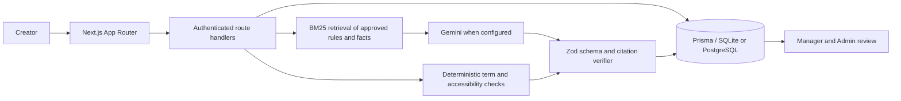

# TrueMark

TrueMark is a prepublication brand-governance workspace. It checks copy and creative assets against approved brand guidance, shows evidence for each concern, and keeps the human review trail. AI suggestions never edit or publish content by themselves.

Built by Team Harshitgurjar00007 for the hackathon.

## Run the demo locally

```bash
npm install
npm run db:push
npm run db:seed
npm run dev
```

Open `http://localhost:3000`. On an empty database, the first account becomes Super Admin. Super Admin creates a separate workspace and Admin credentials for every brand. Each brand Admin then provisions only that brand’s Managers and Creators. Public registration closes after the first account is created.

On a fresh production database, set `SUPER_ADMIN_SETUP_SECRET` to a long one-time code and give it only to the person creating the initial Super Admin. Remove the variable after setup. Without that configured code, public Super Admin registration stays closed.

Local seeded accounts:

| Email | Role | Password |
| --- | --- | --- |
| `superadmin@truemark.test` | Super Admin | `truemark1234` |
| `manager@truemark.test` | Manager | `truemark1234` |
| `creator@truemark.test` | Creator | `truemark1234` |

The seed includes a TrueMark Demo brand, approved demo rules, facts, terms, a sample logo and a starter palette. It keeps an existing workspace Admin and creates a demo Admin only if the workspace has none, avoiding a second Admin in an existing brand. The Super Admin portal creates additional brands and Admin accounts. A brand Admin can replace that brand’s logo/colors under **Brand references**. On a new submission, choose **Try demo creative** to see a deliberately off-brand image move through review.

### Environment

Copy `.env.example` to `.env` and set:

- `DATABASE_URL` — `file:./dev.db` for the currently configured SQLite schema. A hosted PostgreSQL deployment needs a PostgreSQL Prisma datasource migration before launch.
- `AUTH_SECRET` — random value of at least 32 characters.
- `SUPER_ADMIN_SETUP_SECRET` — one-time production bootstrap code for the first Super Admin; remove it after setup.
- `GEMINI_API_KEY` — optional. Without it, text review uses the deterministic mock provider and image review still measures image dimensions and sampled colors locally.
- `GEMINI_MODEL` — optional model override; defaults to `gemini-3.6-flash`.

## What the product does

- Admins maintain approved rules, sourced facts, preferred/banned terms, the canonical logo and an approved color palette. Imported guidance remains a draft until approved.
- Creators submit copy and optionally attach a PNG, JPEG or WebP creative. Submission returns quickly with local checks; a persistent review worker completes text and visual AI checks in the background. Text findings cite an approved source and an exact quote. The visual report checks the creative against the saved logo and palette, measures dimensions and dominant colors, and reviews logo use, proportions, contrast and alt text.
- Accessibility checks estimate reading ease, flag long sentences and identify vague Markdown link labels. They are suggestions for human review, not a compliance certification.
- Creators can accept, edit or dismiss text findings. Revisions are versioned with a word-level comparison. Managers can comment, request changes or approve.
- Repeatedly dismissed guidance appears in **Guideline intelligence** after at least five decisions and a 40% dismissal rate. The Admin edits and reviews a clarification draft; it never changes an approved rule automatically.
- Every review has a print-friendly report that can be saved as PDF from the browser.
- A small labelled review set can be run from each brand’s Admin panel to see precision, recall and citation-validity metrics. A structured feedback form records pilot ratings; only Super Admin can review feedback across brands.
- Super Admin can create multiple isolated brand workspaces and issue one Admin account per brand. Admin libraries, submissions, users, logo/palette settings and insights are scoped to their workspace.

## Architecture



The database supports multiple workspaces per deployment. Server-side role checks and workspace filters protect tenant data. Super Admin has platform-wide access to workspace administration and feedback; brand Admins see only their own workspace. Submitted creative images are optimized and stored in private local or S3-compatible object storage, then streamed only through authorized views. Text passages explicitly marked confidential stay in the private record and are masked before external text-AI review. The creative image and that brand’s approved logo reference are sent to Gemini for visual review when `GEMINI_API_KEY` is configured; the submission form discloses this before upload.

## Technical decisions and external services

| Area | Decision | Reason |
| --- | --- | --- |
| Web app | Next.js 14 App Router, React 18, TypeScript, Tailwind CSS | One deployable app for Super Admin, brand Admin, Manager and Creator workflows. |
| API | Next.js Node.js route handlers | Keeps UI and authenticated server actions in one product. |
| Persistence | Prisma 5; SQLite in the current schema | Low-friction local setup. Convert the Prisma datasource and migrate data before hosted PostgreSQL deployment. |
| Authentication | bcryptjs password hashes, jose-signed JWT in an HTTP-only cookie | Passwords are not stored in plaintext; role authorization is enforced server-side. |
| Validation | Zod for request bodies and model outputs | Rejects invalid inputs and malformed AI responses. |
| Text retrieval | BM25 in TypeScript over approved rules/facts; no hosted vector database | Small, inspectable retrieval path with no extra data service. |
| AI text and vision | Google Gemini `generateContent` REST API, controlled by `GEMINI_MODEL` | Optional language and visual review against a limited set of approved references. Model findings are schema-checked and text citations are verified. |
| Image measurements and optimization | `sharp` | Rotates, down-sizes and converts uploads to WebP before private storage; samples colors locally before visual comparison. |
| Creative storage | Private S3-compatible bucket when configured; private local `.data/private-assets` fallback | Keeps creative bytes out of relational rows and never exposes a public object URL. Use a persistent private bucket for hosted deployments. |
| Review jobs | Prisma-backed queue plus a separate Node worker | Keeps Gemini latency out of the upload request; jobs survive app restarts and retry up to three times. |
| Document extraction | `mammoth` for DOCX and `pdf-parse` for text PDFs | Extracts editable draft text; the uploaded source document is not retained. Scanned PDFs need OCR and are not supported. |
| Version comparison | `diff` | Produces a readable word-level revision comparison. |
| External services | Google Gemini only, when the key is configured | Text drafts with marked passages masked, selected approved guidance, the creative image, alt text and approved logo reference are sent for the requested AI review. AI calls are recorded in `AiCallLog`. |
| Data | Seeded demo guidance plus each workspace's own rules, facts, terms and logo. No third-party training dataset is included. | Findings must be grounded in material approved by the workspace Admin. |

## Main API routes

- `POST /api/auth/login`, `POST /api/auth/logout`, `GET /api/auth/me`, `POST /api/auth/register` — session lifecycle and one-time first-Super-Admin bootstrap.
- `GET|POST /api/superadmin/workspaces`, `GET /api/superadmin/feedback` — create brands/Admins and review feedback across brands.
- `GET|POST /api/admin/library/{rules|facts|terms}`, `PATCH|DELETE /api/admin/library/{kind}/{id}` — Admin-managed approved library.
- `GET|PUT /api/admin/brand-profile` — Admin logo and palette settings.
- `POST /api/submissions` — quickly creates a submission, runs immediate local checks and queues background text/visual review.
- `GET /api/submissions/{id}/review-status` — read the authenticated review-job status.
- `GET /api/submissions/{id}/image` — stream a private creative after workspace authorization.
- `POST /api/submissions/extract` — DOCX/PDF/TXT/MD text extraction.
- `POST /api/findings/{id}/decision`, `POST /api/submissions/{id}/comments`, `POST /api/submissions/{id}/approval` — creator decisions and manager workflow.
- `GET|POST /api/admin/insights` — repeated-dismissal signals and reviewed clarification drafts.
- `POST /api/admin/evaluation` — run the labelled demo set. `POST /api/feedback` captures structured feedback; `GET /api/superadmin/feedback` reviews it across brands.

## Evaluation and feedback

Run the full workflow smoke checks against a running production build:

```bash
npm run build
npm run start
# in another terminal
node scripts/smoke-test.mjs
```

Or start the dev server and run the labelled source-code evaluation:

```bash
npm run dev
# in another terminal
npm run evaluate
```

The labelled set is in `evaluation/labelled-examples.json`. Each brand Admin panel can run the same set interactively against that brand’s library. It is a small seeded demonstrator, not a statistically representative benchmark; record the result and its limitations in the final submission. The Round 1 survey had eight respondents and is early problem validation, not post-build usability evidence. Use the in-app feedback form with Creator and Manager testers and report the actual sample size and results; Super Admin can review feedback across brands.

### Review worker and asset storage

`npm run dev` starts both Next.js and the persistent review worker. On deployment, run `npm start` and `npm run start:worker` as separate long-lived processes against the same database. The worker claims jobs atomically, recovers stale jobs after a restart, retries transient failures up to three times, and records final state on the submission. The submission page polls status and refreshes when the report is ready.

Text and visual review execute concurrently inside the worker. Approved-source BM25 indexes are cached per workspace and rebuilt when the library revision changes. Submission queries and source filters have database indexes. New images are normalized to WebP at a maximum 1600-pixel edge and stored outside the database. Set `S3_BUCKET` and the S3-compatible settings in `.env` for a private AWS S3/R2 bucket; otherwise development uses `.data/private-assets`. Do not use the local filesystem fallback on ephemeral hosting.

## Team contributions

The Round 1 plan assigns these work areas; update them to match the final work completed and individual commits before submitting:

- **Harshit Gurjar — product, research and frontend:** problem research and survey; submission/review experience, comparison view, insights and demo narrative.
- **Harshita Yadav — backend, AI and platform:** database and authentication; retrieval/review pipeline, Gemini integration and output validation, file/image processing, and repository documentation.

Keep each member's final individual contribution statement in their own words, as required by the event.

## Repository and submission

The Round 1 submission lists the source repository as [github.com/hgurjar-creater/TrueMark](https://github.com/hgurjar-creater/TrueMark). Confirm that it is public and contains the final code before submission. Deployment instructions and judge link should be added when a deployment is ready.

## Important product limits

- New brand workspaces begin with an empty approved library; their Admin must add and approve that brand’s guidance before text checks can cite it.
- Palette coverage is a sampled RGB-distance estimate, not a pass/fail brand score. Gemini visual findings can be uncertain; people decide.
- The built-in accessibility checks are heuristic and English-focused. They are not a substitute for assistive-technology testing.
- The seeded evaluation set is intentionally small. Do not present its scores as general product accuracy.
- Image uploads are limited to 3 MB and PNG/JPEG/WebP. Local private files are suitable for development; configure durable private object storage before hosted deployment.
